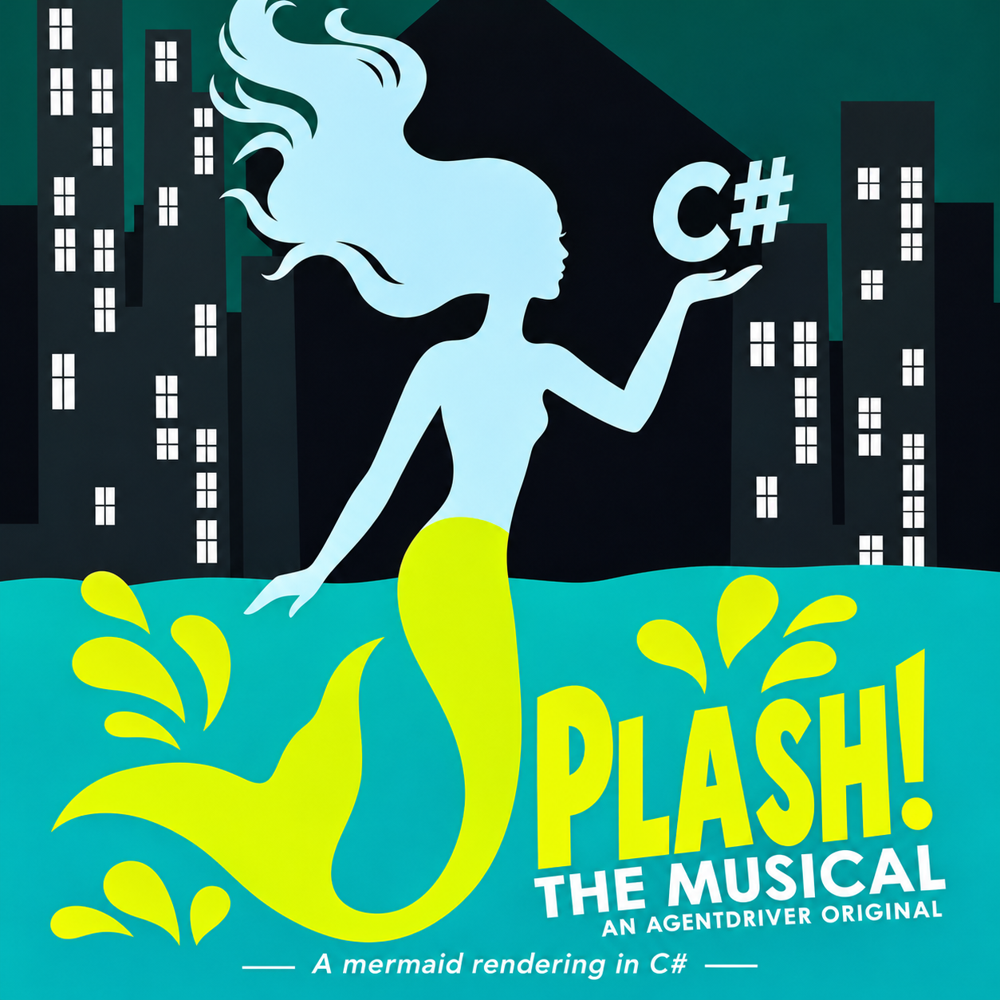
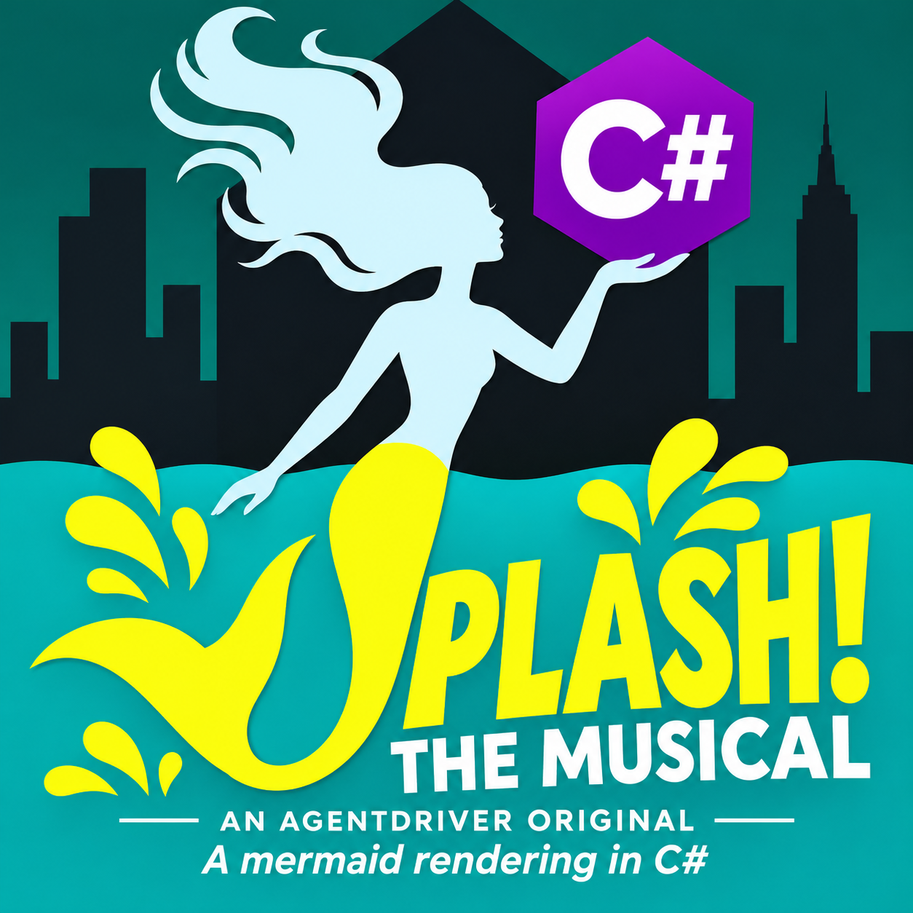
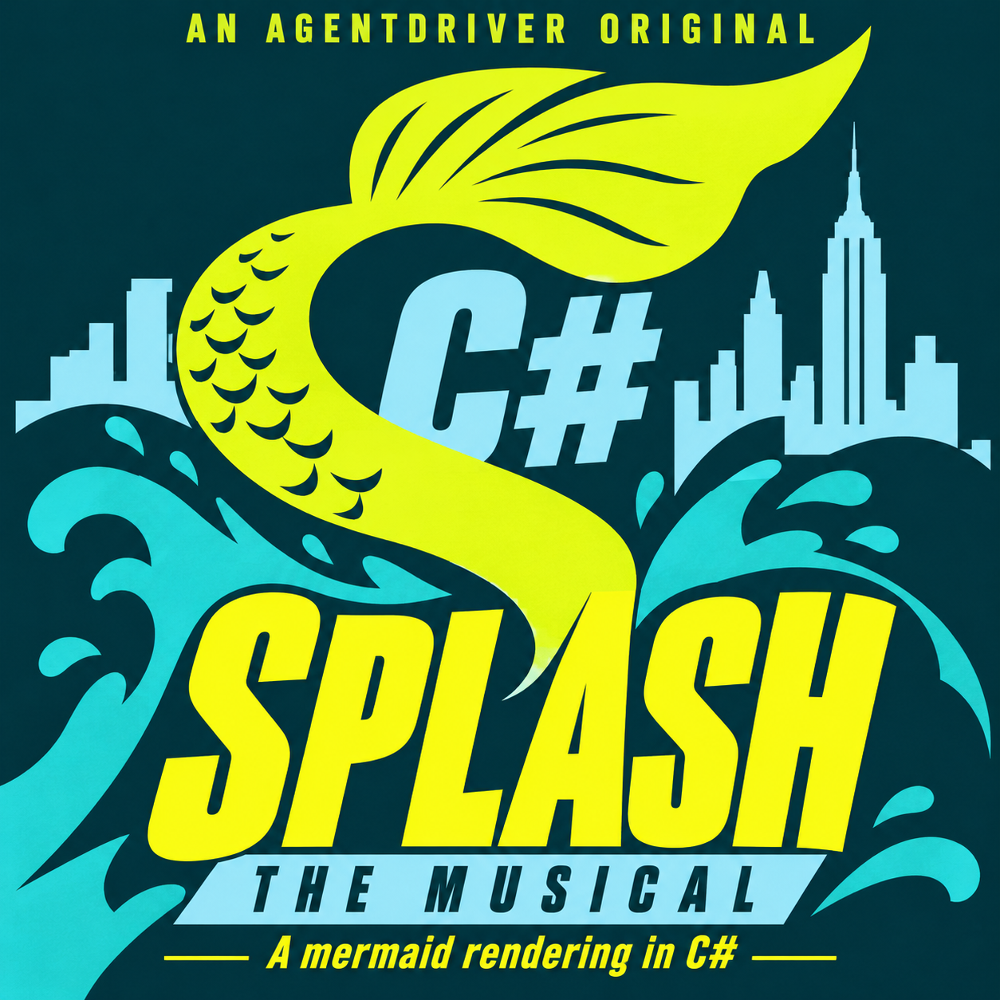
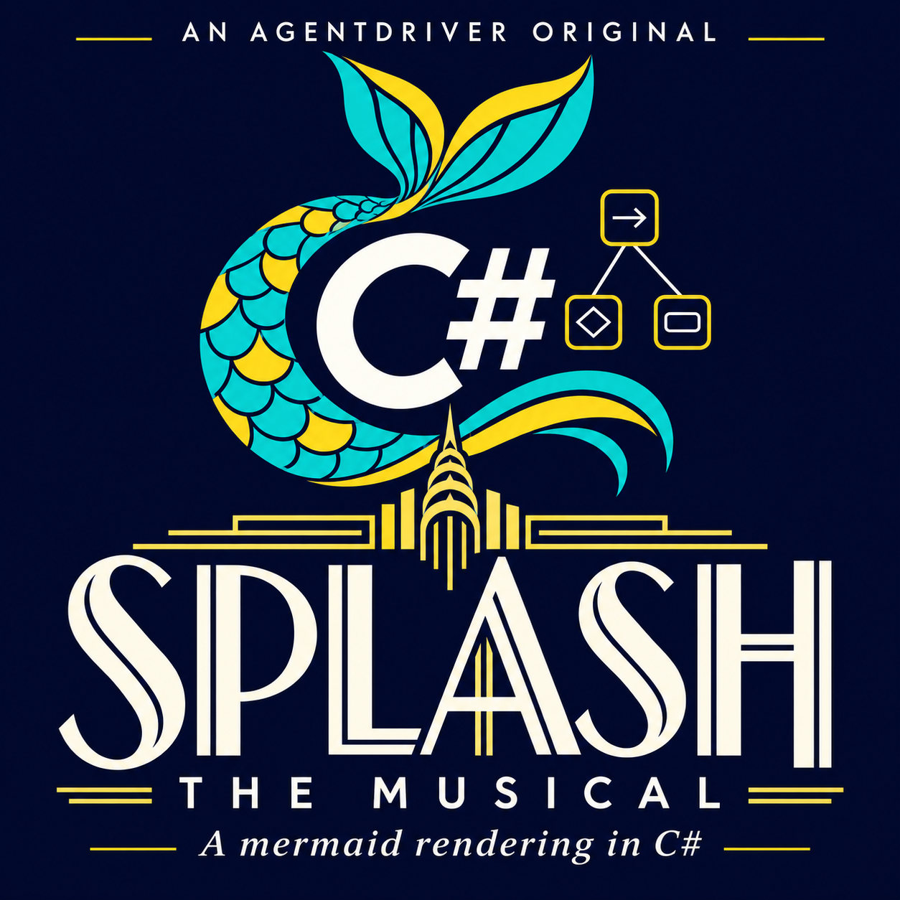
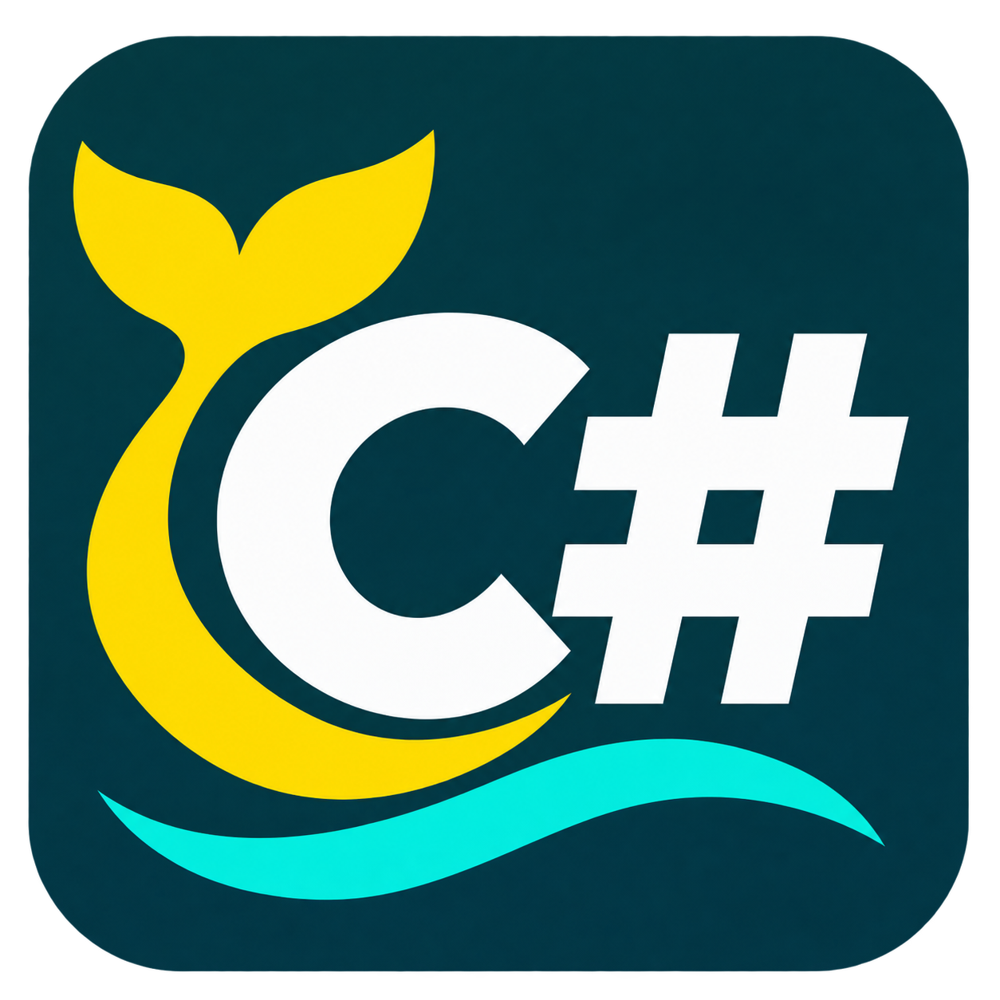
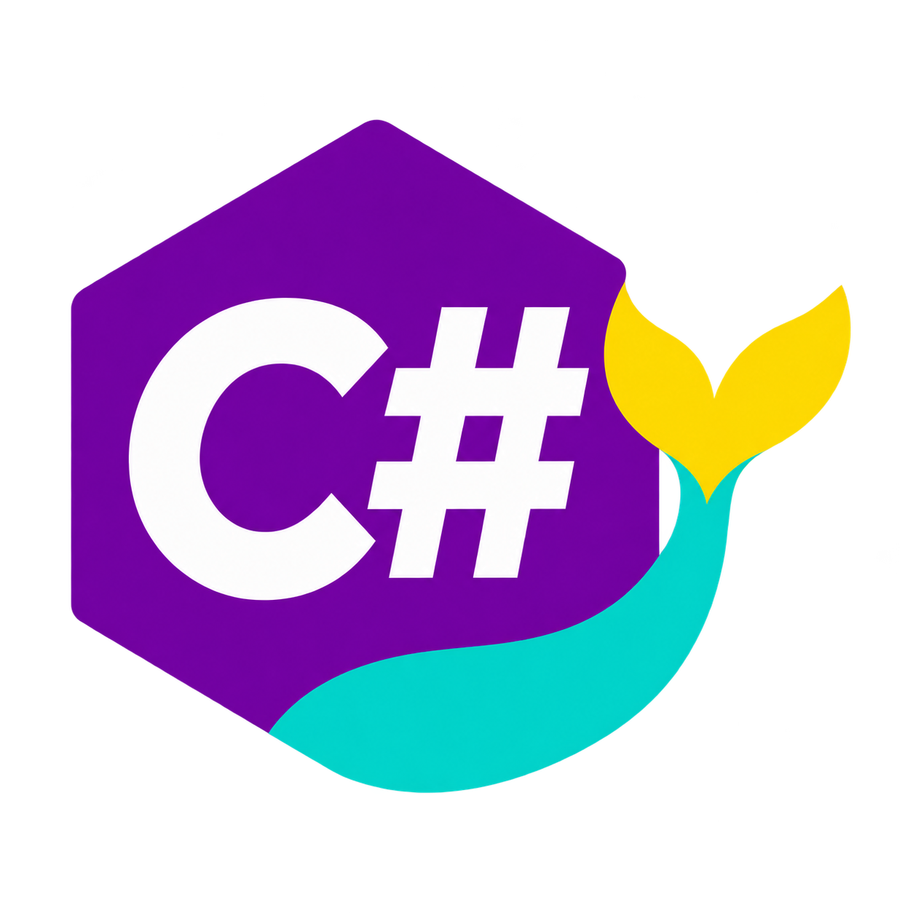

# Splash logo concepts

Generated with the built-in image generation tool. All six original PNG concepts are preserved here, with their exact prompts below.

The **classic poster** is used in the root README. The **purple NuGet icon** is embedded by the source projects' package metadata; packaging remains disabled by default until the release setup enables it.

Select any preview to open the full-size PNG.

| | |
| --- | --- |
| **Classic poster — README** | **Purple badge poster** |
|  |  |
| **Skyline Splash** | **Broadway diagrams** |
|  |  |
| **Teal NuGet icon** | **Purple NuGet icon — selected** |
|  |  |

## Generation prompts

Classic poster — README

Use case: precise-object-edit. Edit target: the attached Splash the Musical poster. Make a faithful high-resolution square adaptation for the software project. Preserve the original composition: black and deep teal NYC skyscrapers, pale icy blue mermaid silhouette with flowing hair and extended right hand, lime yellow tail and SPLASH! lettering, turquoise water and yellow splashes. Replace the tiny seahorse above her raised hand with a clearly readable bold C# symbol in the same pale icy blue, floating just above her palm. Preserve SPLASH! and THE MUSICAL. Replace AN OLIVER PUTNAM ORIGINAL with AN AGENTDRIVER ORIGINAL. Add a clean small but legible bottom caption 'A mermaid rendering in C#'. Keep the charming theatrical cut-paper graphic style, crisp edges, faithful colors, and no extra wording. Deliver just the finished square artwork, not a mockup.

Purple badge poster

Use case: style-transfer. Reference: attached poster; make a second close adaptation for Splash The Musical software branding. Preserve the mermaid, flowing hair, NYC skyline backdrop, turquoise water, acid yellow tail, pale blue silhouette, cut-paper style and large theatrical SPLASH! / THE MUSICAL typography. Replace the seahorse on her palm with a bold purple hexagonal C# emblem with crisp white C# lettering, generously sized and clearly recognizable. Refine the poster into a polished square logo with less tiny skyline detail and strong clean shapes. Exact footer text 'AN AGENTDRIVER ORIGINAL' and 'A mermaid rendering in C#'. Maintain original visual hierarchy. Finished artwork only, no mockup.

Skyline Splash

Use case: logo-brand. Create an original square theatrical logo for 'SPLASH' / 'THE MUSICAL'. Inspired by 1980s NYC mermaid theatre posters: expressive cut-paper shapes, turquoise sea, acid yellow, midnight teal and ice blue. Original composition: a huge sweeping lime mermaid tail curls into an S, breaking a turquoise wave, framing a bold ice blue C# symbol; a minimal Manhattan skyline sits behind it. Beautiful distinctive bold condensed title, sophisticated tightly composed graphic design. Exact smaller text 'AN AGENTDRIVER ORIGINAL' above, and 'A mermaid rendering in C#' below. Flat inks, crisp contours, generous breathing room, no gradients, no mockup, no additional words. Visually original and different from a mermaid person holding a seahorse.

Broadway diagrams

Use case: logo-brand. Create an original premium Broadway meets software logo for Splash The Musical. Square composition, midnight navy background. An elegant geometric mermaid tail in turquoise and bright yellow curls around a prominent white C# symbol, with three minimal diagram nodes joined by thin geometric lines subtly suggesting Mermaid rendering. Art deco NYC theatre lettering: large 'SPLASH', smaller widely spaced 'THE MUSICAL'. Above in small caps 'AN AGENTDRIVER ORIGINAL'. Below 'A mermaid rendering in C#'. Flat vector-like design, strong balanced shapes, refined theatre marquee feeling without bulbs or distressed textures, excellent precise typography. No mockups, no extra text.

Teal NuGet icon

Use case: logo-brand. Create one standalone square NuGet package icon for Splash The Musical, a C# Mermaid renderer. A very bold icy white C# glyph in the center of a deep midnight teal rounded square tile. A single simple vivid yellow mermaid tail curves around the lower left side of the C, ending in a recognizable two-lobed fin at upper left; one clean turquoise wave underlines the glyph. Inspired by exuberant theatrical cut-paper poster shapes, rendered as exceptionally clean flat geometry with thick strokes and large negative spaces. Tiny-size legibility is paramount. Only text is C#. No project title, no subtitle, no branding credit, no border ornament, no shadows, no mockup. The rounded square tile fills 90% of canvas, transparent outside the tile.

Purple NuGet icon — selected

Use case: logo-brand. Create a second distinct standalone square NuGet package logo for Splash The Musical, C# Mermaid rendering software. Main emblem: bold purple hexagon containing a perfectly legible large white C# glyph. Its lower right edge flows into a single simple turquoise mermaid tail with a bright yellow two-lobed fin curling upward alongside the hexagon. Cohesive interlocking emblem, beautifully balanced, minimal flat vector-like shapes. Readable at tiny sizes, very few details, no thin lines, no gradients or shadows. Only text C#. No project name, no subtitle, no credit, no mockup. Center the mark with 10 percent padding on a genuinely transparent canvas.

