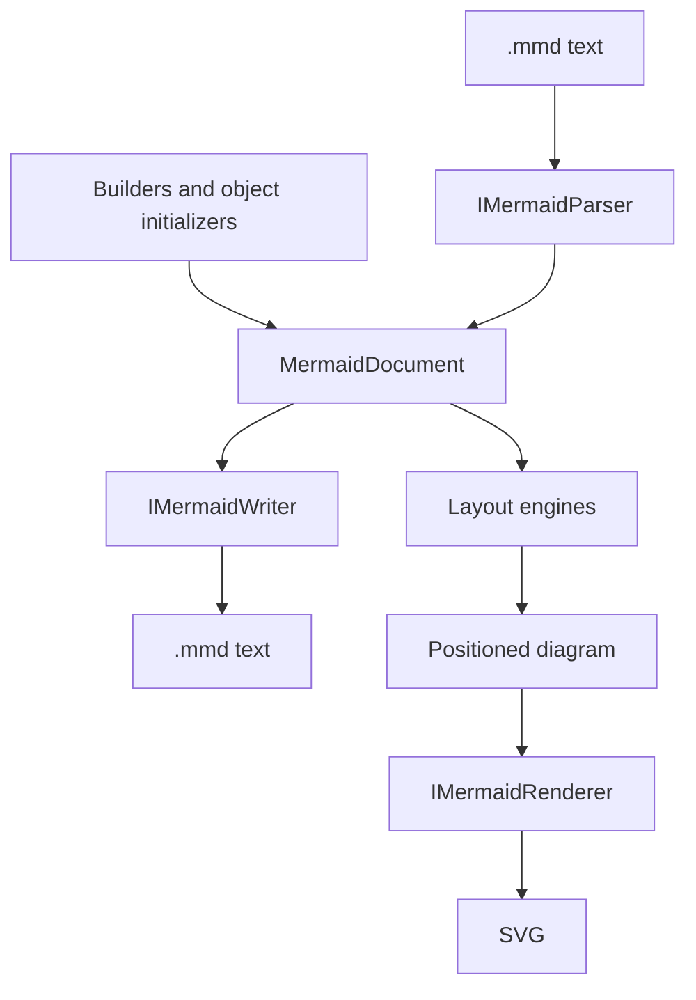
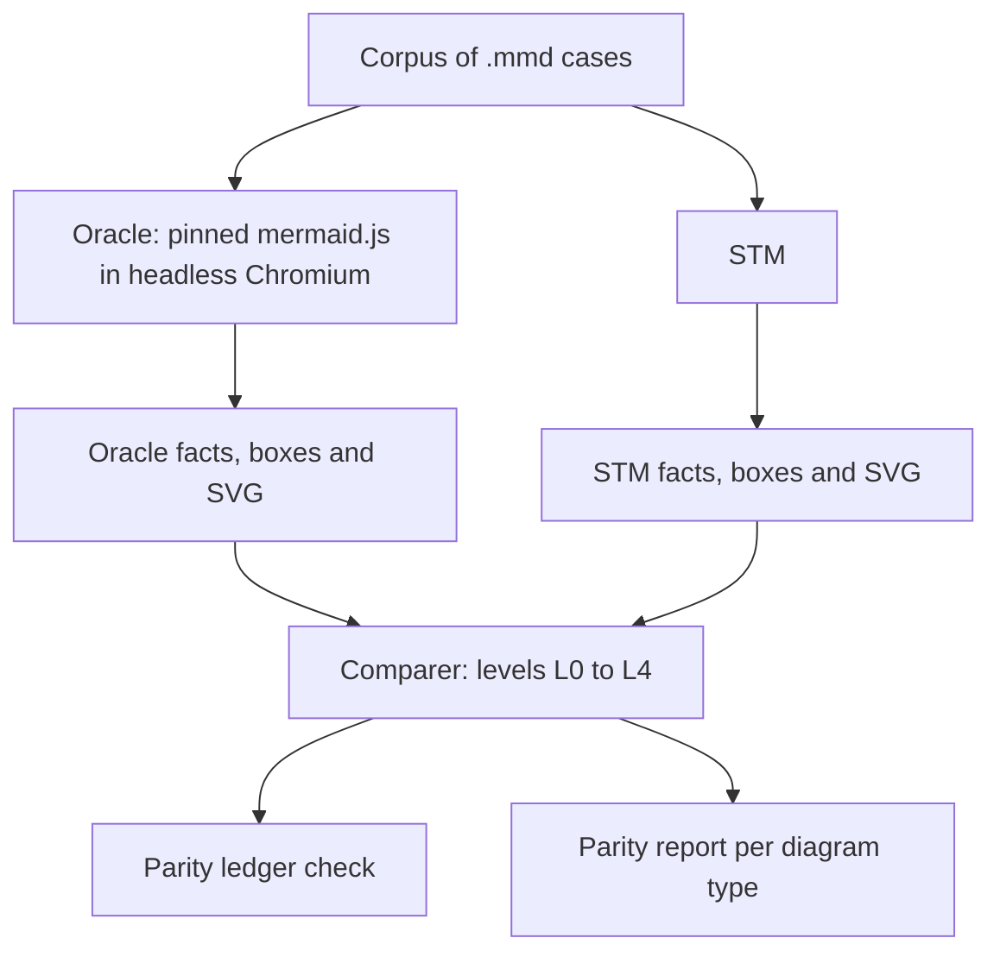

# Plan: full mermaid.js support in SplashTheMusical (STM)

Status: proposal, 2026-11-14. Reference version: mermaid 12.3.0, which is npm `latest` on that date.

## 1. Goal

STM is a C# library that parses, renders and generates Mermaid diagrams. It supports every diagram type and feature
of the current mermaid.js release that makes sense without a browser. A test harness measures the gap between STM and
mermaid.js on every commit, and an update process keeps STM on the latest mermaid.js release.

The requirements, as given:

1. A fully functioning C# implementation of the mermaid renderer.
2. 100% native AOT compatible, and fast.
3. A small, friendly set of classes that work well with dependency injection.
4. A separate DependencyModule project that registers the library in DI.
5. A process that keeps STM current with the latest mermaid.js.
6. Three capabilities on one model: parse `.mmd`, render it, and generate `.mmd`.

### In scope

- Every diagram type mermaid.js registers at the pinned version, including beta types.
- Front matter, `%%{init}%%` directives and the mermaid config schema.
- mermaid's themes and `themeVariables`, `classDef`, `style`, `linkStyle` and `:::class`.
- Node shapes, edge types, markers, Markdown strings, entity codes, icons and image nodes.
- Accessibility (`accTitle`, `accDescr`).
- SVG output. Generating `.mmd` text from a model.

### Out of scope

- Anything that needs a DOM at run time: `click` callbacks, `href` interaction, hover tooltips, `securityLevel`
  sandboxing, `foreignObject` HTML labels. STM draws labels as SVG text.
- `mermaid.run`, `startOnLoad` and the rest of the browser API.
- KaTeX math is deferred to a decision in section 11, because it needs a math typesetter.

### What "full support" means

Parity is measured on five levels. A diagram type is done when it meets the target of every level.

| Level | Question | Target |
|---|---|---|
| L0 Acceptance | Does STM accept and refuse the same sources as mermaid.js? | 100% of the corpus |
| L1 Model | Does STM parse the same nodes, edges, labels and options? | 100%, minus ledger entries |
| L2 Structure | Does STM draw the same elements, shapes, markers and labels? | 100%, minus ledger entries |
| L3 Geometry | Are boxes in the same order, rank and place, at about the same size? | Per-type tolerance |
| L4 Visual | Does a raster of the STM SVG look like the mermaid.js one? | Per-type similarity threshold |

L0 to L2 are exact. L3 and L4 use tolerances, because byte-identical SVG is not a goal and is not reachable without a
browser's text engine.

## 2. What the review of Mermaider found

I reviewed `ipjohnson/mermaider` at `463d3d67`. It is a fork of `nullean/mermaider`, MIT licensed, about 47,000 lines
of C# in `src`.

### Worth reusing

- **The facts harness.** `scripts/mjs-facts.mjs` runs the pinned mermaid.js in headless Chromium and writes a facts
  file per case. `MermaiderFacts` builds the same facts from the C# side and `MjsFactsTests` diffs them. The mermaid.js
  facts are committed, so CI needs no Node. This design is sound and STM should keep it.
- **The corpus scripts.** `scripts/mermaid-docs-corpus.py` and `scripts/mermaid-test-corpus.py` extract diagrams from
  mermaid's docs, its e2e fixtures and its parser tests at a given tag. The corpus has 4,364 cases today.
- **The baseline rule.** Every accepted difference is listed under a reason or an issue. A new difference fails, and
  so does a listed one that no longer occurs.
- **`ResourceLimits` and the cooperative deadline.** STM also takes untrusted input.
- **`SvgSanitizer` and the stylesheet allowlist**, as the security model for output.
- **The `Sugiyama` project**, as a second layered layout engine.
- **`OverlapLint`**, which checks class and sequence diagrams for overlapping labels and boxes.

### Gaps against this goal

| Area | Mermaider today | Consequence for STM |
|---|---|---|
| Parity | `mjs-facts-baseline.txt` holds 9,327 accepted difference lines in 1,784 of 4,364 cases (41%) | The gap is structural, not a list of small bugs |
| Acceptance | Differs in 473 cases: Mermaider accepts 208 sources mermaid.js refuses, refuses 253 it accepts, and crashes on 12 | Line-by-line regex parsing does not follow mermaid's grammars |
| Drawing | 132 cases draw nothing where mermaid.js draws | Unsupported syntax is dropped silently |
| Parsers | 33 `internal` parsers, each a set of `[GeneratedRegex]` patterns applied per line | No shared lexer, and no public parse result for most types |
| Public parse | `MermaidRenderer.Parse` returns `MermaidGraph` for flowchart and state only | Parse is not a real capability yet |
| Generate | No writer exists | Generating `.mmd` is new work |
| API | `static class MermaidRenderer`, with a global `SetLayoutProvider` | Not DI friendly, and global state is shared by every caller |
| AOT | `PublishAot` is set only on `examples/mermaid-aot-smoketest`, which renders five diagrams. No library project sets `IsAotCompatible` | AOT is checked by a smoke test, not by analyzers or the corpus |
| Look | Its own design system: 15 themes such as `zinc-light`, three style presets, a rectilinear edge router | The output is not meant to look like mermaid.js. mermaid's themes are not implemented |
| Config | `DiagramPreprocessor` reads the title, the theme and `themeVariables` | Most of mermaid's config schema is ignored |
| Text | `TextMetrics` estimates width from character classes | Box sizes cannot match mermaid.js |
| Comparison | Structure facts for all types. Boxes for class and sequence only. No raster comparison | L3 and L4 are not measured |
| Types | 28 types. mermaid 12.3.0 also has `agentflow`, `cynefin`, `eventmodeling`, `ishikawa` and `swimlanes` folders | Five types are missing |
| Updates | mermaid is pinned in `package.json`. `dependabot.yml` covers NuGet and GitHub Actions, not npm | A new mermaid release is noticed by hand |

### Decision: STM is a new codebase that takes parts of Mermaider

The model, the parsers, the theming and the public API need a different design, so STM starts fresh in
`ipjohnson/SplashTheMusical`. It copies the harness, the corpus scripts, the resource limits, the sanitizer and the
`Sugiyama` engine, and adapts them. Mermaider and mermaid are both MIT licensed. STM keeps their notices in
`THIRD-PARTY-NOTICES.md`.

## 3. Architecture



`MermaidDocument` is the centre. The parser produces it, user code can build it, the writer turns it into `.mmd`, and
the renderer draws it. Parse, render and generate therefore share one model and one set of tests.

### Solution layout

```
src/
  SplashTheMusical/                    core: model, parsers, writers, config, themes, renderers
  SplashTheMusical.Layout/             graph layout engines, with no knowledge of Mermaid
  SplashTheMusical.DependencyModule/   DI registration
  SplashTheMusical.Cli/                `stm` command, published with native AOT
tools/
  oracle/                              Node: pinned mermaid.js, facts, boxes and raster extraction
  SplashTheMusical.Upstream/           C#: corpus extraction, generated tables, upstream delta report
tests/
  SplashTheMusical.Tests/              unit tests
  SplashTheMusical.Conformance/        the harness: STM against the oracle
  SplashTheMusical.Benchmarks/         BenchmarkDotNet
corpus/                                .mmd cases and committed oracle output
```

The core has no package dependencies. Only `SplashTheMusical.DependencyModule` references DI packages.

### Document model

- `MermaidDocument` is the base class. It holds the front matter, the directives, the config, the title and the
  accessibility text.
- Each diagram type has one document class, for example `FlowchartDocument`, `SequenceDocument` and `ClassDocument`.
- The classes are plain and mutable, with collection properties, so user code can build and edit them with object
  initializers. Layout and rendering only read them.
- The model keeps what the source said, not what the renderer derived. An edge keeps its arrow type and length. A node
  keeps its shape name as written. This is what makes the writer possible.
- The model keeps neither comments nor whitespace, as mermaid's own databases do not. The writer produces one
  canonical format.

### Parsing

- One hand-written lexer and recursive-descent parser per diagram type, over `ReadOnlySpan<char>`. They share a small
  set of lexing helpers for strings, entity codes, Markdown strings, comments and directives.
- Each parser follows the upstream grammar of its type. At mermaid 12.3.0 that is 19 jison grammars under
  `packages/mermaid/src/diagrams/*/parser` and 18 langium files under `packages/parser/src/language`, of which 15 are
  diagram grammars and 3 are shared fragments. `usecase` has neither. Its parser is a hand-written chevrotain lexer,
  parser and visitor. `swimlane` reuses the flowchart grammar. [upstream-map.md](upstream-map.md) names the file for
  each type.
- Each parser source names the upstream grammar file and rule it implements. The update process in section 8 diffs
  those grammar files between versions, so a changed rule points at the C# code to change.
- Errors carry a line, a column and a message. `TryParse` returns diagnostics instead of throwing.
- The default policy is to accept and refuse exactly what mermaid.js does. A deliberate deviation needs a ledger entry.

I considered generating the parsers from the jison and langium files. I rejected it because the jison grammars embed
JavaScript actions and lexer states that cannot be translated mechanically, and a table-driven parser is slower and
gives worse errors than a hand-written one. The grammar diff and the acceptance fuzzing in section 7 cover the drift
that generation would have prevented.

### Writing `.mmd`

- One writer per diagram type, the inverse of its parser. `IMermaidWriter.Write(document)` picks the writer.
- The writer quotes and escapes labels so that any model value survives a round trip.
- Each document class also gets a short fluent builder for the common case.

### Config, directives and front matter

- `MermaidConfig` is generated from mermaid's `packages/mermaid/src/schemas/config.schema.yaml` by
  `tools/SplashTheMusical.Upstream`. The generated C# is committed, so a new config key shows up as a diff.
- Precedence follows mermaid.js: defaults, then site config from the host, then front matter, then directives.
- JSON is read with `Utf8JsonReader`. Front matter and `@{ ... }` node metadata are YAML, read by a small hand-written
  YAML reader for the subset mermaid accepts. Neither uses reflection.
- The host can lock keys, as mermaid's `secure` list does, so untrusted diagrams cannot change them.

### Theming

- STM implements mermaid's themes. At 12.3.0 they are `default`, `base`, `dark`, `forest`, `neutral`, `neo`,
  `neo-dark`, `redux`, `redux-dark`, `redux-color` and `redux-dark-color`.
- The themes are code in mermaid.js, built on colour functions such as darken, lighten and adjust. STM ports the
  functions and each theme's derivation.
- The oracle dumps the computed theme variables of every theme. A test compares STM's computed values with that dump,
  so a theme change upstream fails a test with the exact variable named.
- Mermaider's design system does not come across. It can return later as an extra theme pack.

### Text measurement

Box sizes depend on text width, and mermaid.js gets it from the browser.

- `ITextMeasurer` is the extension point.
- The default measurer uses advance-width tables for a set of common fonts. `tools/SplashTheMusical.Upstream`
  generates the tables from font files, and they are static data.
- A host that needs exact sizes for another font registers its own measurer.

### Layout

`SplashTheMusical.Layout` works on plain graphs and knows nothing about Mermaid.

The defaults below were read at `mermaid@12.3.0`. [upstream-map.md](upstream-map.md) has the row for each type.

| Engine | Default for | Approach |
|---|---|---|
| `elk` | flowchart, class, state, ER, requirement, agentflow, usecase. The top-level `layout` default is `elk` | Use the `Sugiyama` engine from Mermaider, which is layered with orthogonal routing, in #25. Parity is L2 only. Until then flowchart lays out every case with the dagre port, and its cases that mermaid.js draws with ELK are `bug #25` ledger entries at L3. Open decision 8 asks whether that is enough now that ELK is the default |
| `dagre` | No type at default config. A diagram that sets `layout: dagre` gets it, and the `tiny` build falls back to it for `elk` | Port dagre to C#. Geometry parity depends on the same ranking, ordering and coordinate assignment |
| `swimlane` | swimlane | Port mermaid's own lane layout and orthogonal router |
| `cose-bilkent` | mindmap | Port with a fixed seed. Parity is topology, not position |
| `fcose` | architecture, which calls cytoscape-fcose directly | Port with a fixed seed. Parity is topology, not position |
| `tidy-tree` | No type. Mindmap gets it when the host registers `@mermaid-js/layout-tidy-tree` and the diagram asks for it | Port the algorithm |
| d3 and venn.js layouts | sankey with d3-sankey, treemap with the d3-hierarchy tiling, venn with venn.js and fmin | Port each algorithm |
| Arithmetic | block, c4, cynefin, eventmodeling, gantt, gitgraph, info, ishikawa, journey, kanban, packet, pie, quadrant, radar, railroad, sequence, timeline, treeView, wardley, xychart | Per-type code that follows mermaid's renderer |

The types in the `elk` row, swimlane and mindmap accept every registered layout name, which is how a diagram picks
`dagre`, `swimlane`, `cose-bilkent`, the ELK variants or `tidy-tree`. The other types compute positions in their
renderer and ignore `layout`. STM's flowchart ignores `layout` too for now: its module's layout step calls the dagre
port directly. `ILayoutEngine` is the extension point for a host's engine, and no core type uses it yet.

Of the 12.3.0 layout folders, `grid` is not registered and nothing imports it, so it needs no port. `ddlt` holds
data-driven layout test tooling and is not a layout. Edge curves use ports of the d3 curve generators. Mermaid's config
schema accepts 13 `curve` values, 12 d3-shape curves and its own `rounded`, and `insertEdge` draws only those. ELK maps
an edge's curve to any of d3-shape's 19 by name, but `insertEdge` ignores a curve that is not a name.

The dagre port is tested alone. The oracle renders each flowchart, state, class and ER case a second time with
`layout: dagre`, records the graph mermaid.js hands to dagre and the positions dagre returns, and a test replays each
graph through the port.

### Rendering

- One renderer per diagram type, writing through a typed `SvgWriter`.
- `SvgWriter` writes UTF-8 to an `IBufferWriter<byte>`. It can emit only allowlisted elements and attributes, and it
  escapes every text value. Safe output is then a property of the writer, and the hot path does not need a second XML
  pass. The sanitizer stays for user-supplied icons and as a check in tests.
- Element ids and class names follow mermaid.js where it is cheap. Stylesheets written for mermaid output then work,
  and the harness can pair elements by id.
- The `look` values `handDrawn` and `neo` come after `classic`. `handDrawn` needs a port of the rough.js algorithms
  with a fixed seed. At 12.3.0, flowchart, swimlane, agentflow, class, state, ER, requirement, sequence, usecase and
  venn default to look `neo` and theme `redux-color`. Those ten types reach default-config parity only with `neo`.
  Open decision 9 covers the order.
- At 12.3.0 labels are in `foreignObject` by default for every type drawn through `rendering-util` shapes, and for
  journey, timeline, eventmodeling and venn. [upstream-map.md](upstream-map.md) lists each type.

### Diagram modules

Each diagram type is one `IDiagramModule`: a detector, a parser, a writer, a layout step and a renderer. The core has
a static list of its modules. A host can register more, which mirrors mermaid's `registerExternalDiagrams`. ZenUML
ships this way upstream.

## 4. Public API

The API has three services and one facade.

```csharp
public interface IMermaidParser
{
    MermaidDocument Parse(ReadOnlySpan<char> source, ParseOptions? options = null);
    bool TryParse(ReadOnlySpan<char> source, out MermaidDocument? document,
        out IReadOnlyList<MermaidDiagnostic> diagnostics, ParseOptions? options = null);
}

public interface IMermaidRenderer
{
    string RenderSvg(MermaidDocument document, RenderOptions? options = null);
    void RenderSvg(MermaidDocument document, IBufferWriter<byte> utf8Destination, RenderOptions? options = null);
}

public interface IMermaidWriter
{
    string Write(MermaidDocument document, WriteOptions? options = null);
}

public interface IMermaid : IMermaidParser, IMermaidRenderer, IMermaidWriter
{
    string RenderSvg(ReadOnlySpan<char> source, RenderOptions? options = null);
}
```

Use with DI:

```csharp
public sealed class ReportService(IMermaid mermaid)
{
    public string Draw(string source) => mermaid.RenderSvg(source);
}
```

Use without DI:

```csharp
var svg = Mermaid.Default.RenderSvg("flowchart LR\n  A --> B");
```

Generate a diagram:

```csharp
var chart = new FlowchartBuilder("LR")
    .Node("a", "Start")
    .Node("b", "Done", "stadium")
    .Edge("a", "b", "ok")
    .Build();
string mmd = mermaid.Write(chart);
string svg = mermaid.RenderSvg(chart);
```

Rules for the API:

- Every service is stateless and thread safe, so each registers as a singleton.
- There is no global mutable state. `Mermaid.Default` is an immutable instance built from the default modules.
- Extension points are interfaces resolved from the container: `ITextMeasurer`, `IIconProvider`, `ILayoutEngine`,
  `IThemeProvider` and `IDiagramModule`.
- `MermaidOptions` holds the site config, the resource limits and the locked keys. A per-call options argument
  overrides it.
- Exceptions follow Mermaider's shape: `MermaidParseException`, with `MermaidResourceLimitException` derived from it.
- The public API is tracked by an API diff in CI, as Mermaider does.

## 5. The DependencyModule project

`SplashTheMusical.DependencyModule` registers the library and holds no logic. The facts below were read from
ipjohnson/DependencyModules at `v1.7.0` and checked with a native AOT sample.

### Packages and names

| Item | Value |
|---|---|
| Runtime package | `DependencyModules.Runtime` 1.7.0. It has the attributes, the interfaces and `AddModule`. It targets `net8.0` and `net10.0` and sets `IsAotCompatible` |
| Generator package | `DependencyModules.SourceGenerator` 1.7.0. It runs only at compile time, and the project references it with `PrivateAssets="all"` |
| Module attribute | `[DependencyModule]` in `DependencyModules.Runtime.Attributes`, on a `partial` class at namespace level |
| Registration hook | `IServiceCollectionConfiguration.ConfigureServices(IServiceCollection)` in `DependencyModules.Runtime.Interfaces`. It runs after the module's generated registrations |
| Load method | `services.AddModule<T>()` in `DependencyModules.Runtime`. `T` needs a parameterless constructor |
| Generated attribute | `[SplashTheMusicalModule]`. Another module puts it on its class to depend on this one |

The generator also writes `PopulateServiceCollection`, an `Equals` that compares only the module type, and the
attribute's `GetModule`, which calls `new SplashTheMusicalModule()`. None of it uses reflection.

### Registering types from another assembly

The service attributes (`[SingletonService]`, `[ScopedService]`, `[TransientService]`, `[CrossWireService]`) register
only classes in the module's own project. The core has no attributes, so the module needs another route. There are
three, and all three passed in the AOT sample:

1. **Code in `ConfigureServices`.** The module implements `IServiceCollectionConfiguration` and calls `TryAddSingleton`
   and `TryAddEnumerable` for each core type. Every type is named in one place.
2. **A convention over the core assembly.** The module implements `IConventionModule` and writes
   `conventions.RegisterAll<IDiagramModule>().InAssemblyOf<FlowchartModule>().Using(RegistrationType.TryEnumerable).AsSingleton()`.
   The generator reads the statement at compile time and writes one registration per public class it finds.
3. **Static factory methods in the module project.** Each method returns a core type and carries
   `[SingletonService(Using = RegistrationType.Try)]`. This needs one method per service.

STM uses option 1. AGENTS.md requires diagram modules to be listed explicitly, which rules out option 2 for
`IDiagramModule`. A convention would also register any public implementation added to the core later, including
ones not meant for DI. Option 3 spreads the registration type across attributes and adds a method per service.

`MermaidOptions` is an immutable record with `init` properties, so an `Action<MermaidOptions>` cannot change it, and
`IOptions<MermaidOptions>` does not fit. A configure step is a `Func<MermaidOptions, MermaidOptions>` that a host writes
with `with`. `services.ConfigureMermaid(...)` registers one step, and `AddSplashTheMusical(...)` registers its argument
as one. The module registers `MermaidOptions` as a singleton that runs every step in registration order from
`MermaidOptions.Default`, so a step may come before or after the module. A host that registers its own
`MermaidOptions` replaces the steps. I rejected a module constructor parameter. `GenerateUseMethod` does turn it into a
working `AddX(Action<MermaidOptions>)` method, but the module then has no parameterless constructor, so `AddModule<T>()`
fails, and the generated attribute cannot carry a delegate.

### The module

`src/SplashTheMusical.DependencyModule/SplashTheMusicalModule.cs` is the module. Its `ConfigureServices` calls
`TryAddSingleton` for `MermaidOptions`, `ITextMeasurer`, `IIconProvider`, `IThemeProvider`, `IMermaid`,
`IMermaidParser`, `IMermaidRenderer` and `IMermaidWriter`, and `TryAddEnumerable` for each instance of
`Mermaid.CoreModules`. The three services resolve to the `IMermaid` instance. A factory builds `Mermaid`, so no
constructor is chosen by reflection. It passes every `ILayoutEngine` in the container, and every `IDiagramModule`
that is not one of `Mermaid.CoreModules`, because `Mermaid` adds the core modules itself.

A host's `ITextMeasurer` registered after the module wins too, because `GetService` gives the last registration.
`DependencyModuleTests` checks both orders.

`samples/SplashTheMusical.Sample` is a host that loads the module and renders `info`. CI publishes it with native AOT
and runs it.

### Behaviour the spike's sample checked

The spike of #3 compiled a stand-in core assembly with no reference to DependencyModules. Its sample was a console app with `PublishAot`. It ran ten checks under JIT and again as the native binary, and all
passed. The `dotnet publish` output had zero warnings.

| Check | Result |
|---|---|
| Default registration | `IMermaid` resolves with the default options, `DefaultTextMeasurer` and both diagram modules |
| Lifetime | `IMermaid` resolves to the same instance twice |
| Host registers `ITextMeasurer` before the module | The host's measurer wins and there is one registration, because of `TryAdd` |
| Host replaces `ITextMeasurer` after the module | `services.Replace(...)` leaves one registration, and `Mermaid` gets the host's measurer |
| Module added three times, by `AddModule` twice and `AddSplashTheMusical` once | Two diagram modules and one `IMermaid` registration. Each `AddModule` call loads the module again, so `TryAdd` is what prevents duplicates |
| Host adds an `IDiagramModule` | `Mermaid` gets the host's module and both core modules |
| `AddSplashTheMusical(o => o.Theme = "dark")` | `Mermaid` sees `dark` |
| `services.Configure<MermaidOptions>(...)` after the module | `Mermaid` sees the configured value |
| Convention with `InAssemblyOf<FlowchartModule>()` | Registers both core diagram modules |
| Host module with `[SplashTheMusicalModule]` | Loading the host module loads this one |

The spike used `IOptions<MermaidOptions>` and an `Action<MermaidOptions>` against a stand-in whose options were
mutable. The real `MermaidOptions` is immutable, so the project uses the configure steps described above.

The generator package reached the spike's console app through the project reference. The project sets
`PrivateAssets="all"` on it, so a host that writes its own `[DependencyModule]` references the generator itself.

## 6. AOT, performance and size

### AOT

- `IsAotCompatible` is `true` for every project in `src`. That turns on the trim, AOT and single-file analyzers, and
  warnings are errors.
- The code has no reflection, no `dynamic`, no `Activator`, no runtime code generation and no `Regex` built at run
  time.
- Lookup tables are static data. Diagram modules are listed explicitly.
- CI publishes `SplashTheMusical.Cli` and the conformance runner with `PublishAot` on Linux, macOS and Windows. ILC
  warnings fail the build.
- The native conformance runner executes L0 to L3 on the whole corpus. AOT is therefore proven by the same cases as
  the JIT build, not by a smoke test.

### Performance

- Parsers lex spans in one pass. They do not split the source into line strings and they do not use regex. The next
  subsection lists the parser techniques.
- The renderer writes UTF-8 directly and can stream to a pipe without building a string.
- The stylesheet is built from typed rules on each render. It is not cached per theme and config.
- The layout engine uses index-based graph buffers, as Mermaider's CSR `GraphBuffer` does.
- `ResourceLimits` and the cooperative deadline come across from Mermaider with the same defaults.

### Parser techniques

Mermaid diagrams are small, usually under 10 KB. The fastest parser is therefore the one with the lowest fixed cost
per call: no regex, almost no allocations and no startup work. Throughput on large inputs comes second.

Lexing:

- **One buffer.** The lexer walks the source as a `ReadOnlySpan<char>`. It never splits the source into lines and
  never trims into new strings. Mermaider's `PreprocessLines` does both before parsing starts.
- **Struct tokens.** A token is a kind, a start and a length. A label becomes a `string` once, when it is stored in
  the model.
- **Vectorized scanning.** `SearchValues<char>` with `IndexOfAny` and `IndexOfAnyExcept` skips whitespace and finds
  the end of an identifier, a label or a line. .NET runs these with AVX2, AVX-512 or NEON. Most of a diagram is
  identifiers and label text, so the lexer spends most of its time in these calls.
- **No regex.** The lexer dispatches on the first character with a `switch`. Keywords are matched by a `switch` over
  the span, which the compiler turns into length and character checks.
- **Escape fast path.** The lexer flags a label that contains an entity code or an escape. A label without the flag
  is a plain substring of the source.
- **Lexer modes as state.** The jison grammars use lexer start conditions, for example inside a string or a
  directive. Each mode is a method in the hand-written lexer, so the mode costs a call and not a table lookup.

Parsing:

- **No backtracking.** Each parser is recursive descent over tokens it never re-lexes. It decides on the next token,
  and on the one after it only where the grammar needs two, as flowchart's `((` and `{{` do. It may move back over
  tokens it has only looked at, as flowchart's `&` chain does, but never after it has built model state. Flowchart
  edges such as `-- text -->` and `-.->` get a dedicated scanner, so the parser never tries a rule and undoes it. The
  lexer may lex the whole input before parsing starts, because the tokens do not depend on the parser.
- **No exceptions on the parse path.** Diagnostics are values. `TryParse` never throws on bad input, and `Parse`
  throws once, at the end, from the collected diagnostics.
- **One-pass detection.** The diagram type comes from a `switch` on the first keyword after the front matter, the
  directives and the comments. mermaid.js tries its detectors in order.
- **Interned ids.** A node id such as `A` repeats on many lines. A per-parse table keyed by span, `IdTable`, maps each
  id to an integer, so each distinct id allocates one string. The model stores ids as strings, so user code can build
  documents, and the layout step builds its own indexes from the model.
- **Deferred work.** The parser keeps Markdown strings and style values as text. The renderer reads them when it
  needs them. Front matter and `%%{init}%%` are parsed only when present, which the first characters decide.
- **Cheap limit checks.** `ResourceLimits` and the deadline are checked per statement, not per character.

Allocation:

- **The model is the only allocation.** Scratch space comes from `stackalloc` and `ArrayPool`. Collections are built
  in pooled buffers and copied once at their final size.
- **Pre-sizing.** A vectorized count of newlines gives a cheap estimate for collection capacity.
- **Span lookups.** Larger tables, such as the shape names and their aliases, use
  `GetAlternateLookup<ReadOnlySpan<char>>`, so a lookup allocates nothing.

Native AOT:

- **No virtual calls in hot loops.** Native AOT has no tiered JIT and no dynamic PGO, so it cannot devirtualize from
  a profile. The lexer is a `ref struct` passed by reference, and the parser classes are sealed.
- **Little startup cost.** The large generated tables, such as the font widths, are static data in the binary,
  written as `static ReadOnlySpan<byte>` properties. Small lookup tables are `static readonly` `FrozenSet` and
  `FrozenDictionary` values, built once per process when their type is first used.

Excluded, because the gain does not justify the cost:

- **Unsafe code and hand-written intrinsics.** `SearchValues` already gives the SIMD paths.
- **A second lexer for UTF-8.** UTF-8 input is transcoded once into a pooled buffer.
- **Parallel parsing.** A single diagram is too small to benefit. A host that renders many diagrams runs them in
  parallel itself, which the stateless services allow.

### Budgets and gates

- The first benchmark run measures Mermaider on a fixed set of diagrams, in `docs/benchmarks/mermaider-baseline.md`.
  STM's budget is to parse no slower and to allocate no more than Mermaider on that set. `BudgetTests` fails when a
  committed parse row is over it. Layout, render and write are measured and not gated: flowchart's render is over
  Mermaider's (#158). mermaid.js's own parse time in Node is recorded as a second reference.
- `SplashTheMusical.Benchmarks` covers parse, layout, render and write for a small, a medium and a large case of every
  supported type. It reports nanoseconds and bytes allocated per source character, on JIT and on native AOT, and
  `docs/benchmarks/stm.md` holds the committed run.
- `mise run bench-compare` compares a run with the committed numbers and fails on a regression above 10% in time or
  allocation. CI's `benchmarks` job runs STM and Mermaider on one macOS runner, checks the budget on that run and
  uploads both result files. The committed files come from that artifact.
- Allocation tests assert the exact bytes allocated for small diagrams, which catches accidental allocations at once.
- A fuzz job feeds mutated corpus cases to the parser under the resource limits and fails on a crash or a missed
  deadline.

### Expected size

These are estimates. They come from two measurements: Mermaider's source and binaries, and mermaid 12.3.0's source.

Reference points, measured on 2026-11-14:

| What | Size |
|---|---|
| Mermaider `src/Mermaider` | about 37,000 lines of C#, for 28 diagram types with no writer |
| Mermaider `src/Sugiyama` | about 9,100 lines |
| Mermaider tests | about 26,500 lines of C# and 2,400 lines of scripts |
| mermaid 12.3.0 `packages/mermaid/src`, without tests, jison grammars and dependencies | 117,287 lines, of which 92,769 are code |
| `Mermaider.dll` and `Sugiyama.dll`, release | 1.6 MB and 0.2 MB |
| Mermaider's native AOT smoke test, osx-arm64 | 12.9 MB |

The native AOT figure was built with the .NET 11 preview SDK on this machine, so it is indicative. It includes the
runtime, the generated regex code, `System.Xml` for the sanitizer and `System.Text.Json`.

Estimate for STM at 1.0, in lines of C#:

| Part | Lines | Basis |
|---|---|---|
| Document model | 6,000 to 8,000 | Mermaider's models are 2,300 lines and keep less of the source |
| Lexers, parsers, config, YAML and JSON readers | 20,000 to 25,000 | Mermaider's regex parsers are 10,900 lines. Hand-written parsers are longer, and five types are new |
| Writers and builders | 6,000 to 8,000 | New |
| Themes and generated config | 8,000 to 10,000 | mermaid's themes are 4,100 lines of code and the khroma functions they use are under 931 |
| Renderers, shapes and looks | 25,000 to 30,000 | Mermaider's renderers are 16,800 lines without mermaid's shape set or looks |
| Layout assembly | 35,000 to 45,000 | The ports below come to 33,500 lines of source code. `Sugiyama` and the per-type arithmetic layouts come on top |
| Text tables, icons, limits, sanitizer | about 4,000 plus data | |
| DependencyModule and CLI | under 1,000 | |
| **Product code** | **105,000 to 140,000** | Mermaid's own source is 117,000 lines |
| Tests and harness | 30,000 to 40,000, plus about 3,000 lines of Node | |
| Corpus | 4,400 cases today, with two committed oracle files per case | |

Estimate for the shipped binaries:

- The core assembly is 3.5 to 5 MB and the layout assembly about 0.6 MB. The NuGet package is 1.5 to 2 MB compressed.
- The native AOT CLI is 8 to 15 MB. STM has more code than Mermaider, but it drops the regex engine and reads JSON
  with `Utf8JsonReader`.
- Icon packs ship as separate packages, because a full pack is several megabytes.
- CI records the size of the core assembly and of the native AOT CLI. A pull request that grows either by more than
  5% fails until the new size is accepted.

The dependency ports were measured at the versions mermaid 12.3.0's lock file pins. "Code" counts lines that are not
blank and not comments, without tests and type declarations. [upstream-map.md](upstream-map.md) has the count per
package.

| Port | Used by | Packages | Code lines |
|---|---|---|---|
| dagre and graphlib | `layout: dagre`, and flowchart's node intersection | dagre-d3-es 7.0.14 `src/dagre`, `src/graphlib` and `src/dagre-js/intersect` | 3,182 |
| d3 curves | Edges of every graph type | d3-shape 3.2.1 curves, line, area and point, d3-path 3.1.1 | 1,157 |
| Colour functions | Themes | khroma 2.1.0, of which the themes use 10 functions | 931 at most |
| cose-bilkent | mindmap | cytoscape-cose-bilkent 4.1.0, cose-base 1.0.3, layout-base 1.0.2 | 4,722 |
| fcose | architecture | cytoscape-fcose 2.2.0, cose-base 2.2.0, layout-base 2.0.1 | 7,619 |
| tidy-tree | mindmap with `@mermaid-js/layout-tidy-tree` | non-layered-tidy-tree-layout 2.0.2 and the adapter package | 967 |
| rough.js | `handDrawn` look, ishikawa, venn | roughjs 4.6.6, hachure-fill, path-data-parser, points-on-curve, points-on-path | 2,099 |
| Swimlane layout | swimlane | mermaid's `layout-algorithms/swimlanes` | 10,567 |
| Venn layout | venn | @upsetjs/venn.js 2.0.0 and the fmin 0.0.4 code it bundles | 1,663 |
| Sankey and treemap | sankey, treemap | d3-sankey 0.12.3, d3-hierarchy 3.1.2 treemap tiling | 595 |
| **Total** | | | **33,502** |

cose-bilkent and fcose depend on different major versions of cose-base and layout-base. A port that shares one graph
model between them would be smaller than the sum. The total leaves out ELK. elkjs 0.12.0 is GWT output of Eclipse ELK's
Java, 4.8 MB in one file, so a port of ELK layered would be sized from the Java source.

## 7. The test harness

The harness is built first. With it in place, every later change has a number.



### Oracle

`tools/oracle` is the Node side. It starts from Mermaider's `scripts/mjs-facts.mjs`.

- It pins mermaid, `@mermaid-js/mermaid-zenuml`, the layout packages and puppeteer in `package-lock.json`.
- It renders every case in one headless Chromium page, in UTC, on a fixed clock, with a bundled font loaded through
  the FontFace API before mermaid loads. Two runs write the same files.
- Per case it writes: acceptance and the error message, the model facts from the diagram's db, the structure facts
  from the DOM, the bounding box of every identified element, the canvas size, and the SVG.
- It also writes the computed theme variables per theme, the default config, the shape table and the dagre inputs and
  outputs.
- The facts and boxes are committed under `corpus/`. The SVGs and rasters are build artifacts, cached by mermaid
  version and corpus hash.

### Corpus

| Source | Cases today | Purpose |
|---|---|---|
| mermaid's e2e fixtures | 2,007 | What mermaid.js tests visually |
| mermaid's parser tests | 1,439 | Grammar corners, including sources it must refuse |
| mermaid's syntax docs | 499 | What users copy |
| Hand-written cases and repros | about 420 | Bugs found in the field |
| Feature matrix | new | One case per shape, edge type, marker, theme and config key, generated from the tables |
| Fuzz finds | new | Minimized cases where STM and mermaid.js disagreed |

mermaid.js accepts 4,055 of today's 4,364 cases and refuses 309. The refused ones matter as much for L0.

### Comparison levels

- **L0 and L1** compare committed facts. They need no Node and run in every test run, on JIT and on native AOT.
- **L2** compares structure facts: which elements are drawn, with which shape, marker and label.
- **L3** compares boxes after aligning the two canvases. Starting tolerances are: canvas size within 5%, the same rank
  and order of nodes per axis, each box overlapping its counterpart by at least 80%, and no overlap that mermaid.js
  does not have. Tolerances are set per diagram type and only tighten.
- **L4** rasterizes both SVGs in the same Chromium, so differences come from the SVG and not from the rasterizer. It
  scores structural similarity. The starting threshold is 0.90 for types on a ported layout, and L4 is report-only for
  force-directed types.

### Font control

The oracle and STM use the same bundled open-licensed font in the harness. The font is Liberation Sans 2.1.5, under the
SIL Open Font License, in `tools/oracle/fonts`. Its widths match Arial's. STM's width table for that font comes from
the same font files. Text width then stops being a source of difference, and what remains in L3 is layout.

### Parity ledger

- One ledger file per diagram type lists every accepted difference at L0 to L3 under a category: `by-design`,
  `out-of-scope` or `bug` with an issue reference. L4 outcomes are committed per case in `corpus/l4.txt`, and the L4
  job fails when they change.
- A new difference fails. A listed difference that no longer occurs fails, so the ledger cannot go stale.
- The count of `bug` entries per type is published and may only go down within a mermaid version.

### Generation tests

- **Round trip.** For every accepted case, `Parse(Write(Parse(text)))` equals `Parse(text)`. `RoundTripTests` checks
  every module of `Mermaid.CoreModules`: the written text writes back to itself and gives the same preamble, facts,
  boxes and SVG. A type may add a model comparison of its own, such as `FlowchartRoundTripTests`.
- **Oracle round trip.** The oracle renders the text STM wrote. Its facts must equal the facts of the original text.
  This proves mermaid.js reads what STM generates. `mise run oracle-roundtrip` runs it, and so does CI's `l4` job.
  Where the written text's facts differ from the committed ones, the oracle also renders the original on the same
  machine, and the two must agree, so the platform's fonts do not decide the result.
- **Property tests.** CsCheck generates random documents per type, writes them, and checks both properties: 10,000
  documents per type must read back equal in the default test run, and the oracle must accept 100 of them in the `l4`
  job. `DocumentGenerators` lists the generators, and `docs/adding-a-diagram-type.md` says how a type adds one.

### Differential fuzzing

A scheduled job mutates corpus cases and generates sentences from the upstream grammars. It runs each through the
oracle and STM and keeps any case where acceptance or facts differ. Minimized finds join the corpus.

### Reports and CI

- Every run writes a parity report: a table of diagram type by level, with the pass rate and the ledger counts.
- The report is published with the docs, and the README shows the totals.
- Pull request CI runs unit tests, L0 to L3 on JIT and native AOT, the budget check of the committed benchmarks, the
  size check and the API diff. None of them needs Node.
- A second job with Node runs L4 and checks that the committed oracle output is what the pinned mermaid.js produces.

## 8. Staying current with mermaid.js

The rule is that the oracle is always the latest mermaid.js release. STM's distance from it is the published parity
report.

1. **Detect.** Dependabot watches `tools/oracle/package.json`. A scheduled workflow also polls the npm `latest` tag
   daily, so a release is seen within a day.
2. **Bump.** `mise run upstream-bump <version>` does the mechanical work: it installs the version, re-extracts the
   corpus from the upstream tag, regenerates the oracle output, and regenerates `MermaidConfig`, the shape table and
   the theme dumps.
3. **Report.** The same task writes an upstream delta report into the pull request:
   - diagram types added or removed, from `packages/mermaid/src/diagrams` and the detector registrations
   - grammar files changed, with the diff of each jison and langium file and the C# parser that implements it
   - config keys added, removed or changed
   - theme variables whose computed value changed
   - shapes, edge types and layout algorithms added
   - corpus cases added, removed, or with changed oracle facts
   - conformance results: what newly fails
4. **Triage.** Small failures are fixed in the bump pull request. Each remaining one becomes an issue and a `bug`
   ledger entry. The bump merges within a week of the release, so the pin never falls behind and the debt is visible.
5. **Pre-release canary.** A weekly job runs the conformance suite against the pre-release tag and posts the delta
   report to a tracking issue. It does not block. `13.0.0-alpha.3` is published today under `v13-alpha`, so the canary
   has a target from the first day.
6. **Release.** Every STM release names the mermaid.js version it was verified against, in the release notes and in
   `MermaidCompatibility.MermaidJsVersion`.

A new upstream diagram type follows [adding-a-diagram-type.md](adding-a-diagram-type.md): where each part lives, the
parser rules, the oracle extractor, the ledger and tolerances, the tests and benchmarks, the order of work, the shared
files and the definition of done. It was written from the flowchart work.

## 9. Roadmap

Each phase ends when its exit criteria hold on JIT and on native AOT.

| Phase | Work | Exit criteria |
|---|---|---|
| 0. Harness | Repository, build, CI. Oracle, corpus, comparer, ledger and report. A stub STM that refuses everything | The report runs in CI and shows 0%. The oracle output is reproducible |
| 1. Core | Lexing helpers, `MermaidDocument`, config, front matter, directives, themes, text measurement, `SvgWriter`, the three services, the DependencyModule project, the CLI, AOT and benchmark gates | Theme and config tests pass against the oracle dumps. An empty diagram renders through DI on native AOT |
| 2. Flowchart | Flowchart end to end, with the dagre port, all shapes, subgraphs, Markdown strings and styling | Flowchart meets the definition of done of [adding-a-diagram-type.md](adding-a-diagram-type.md): L0 at 100%, every L1 to L3 difference in the ledger with an issue, L4 outcomes committed, and the round-trip tests pass. This phase proves the design |
| 3. Graph types | State, class, ER, requirement, block, C4 | Each type meets its targets |
| 4. Sequence types | Sequence and ZenUML | Each type meets its targets |
| 5. Charts | Pie, quadrant, xychart, radar, sankey, gantt, timeline, journey, gitgraph, packet, kanban, treemap, venn | Each type meets its targets |
| 6. Remaining types | Mindmap, architecture, treeView, usecase, wardley, railroad, ishikawa, cynefin, eventmodeling, agentflow, swimlanes | Every type mermaid.js registers is supported |
| 7. Extras | `elk`, `handDrawn` and `neo` looks, icon packs, the decision on math | L2 parity for each |
| 8. 1.0 | One real mermaid.js bump done through the update process. Docs. Public API review | The parity report meets the targets in section 1. No `bug` entry is older than one mermaid release |

Phases 3 to 6 are independent per diagram type after phase 2, so they can run in parallel. Within a phase, types are
ordered by how often they are used. Each type follows [adding-a-diagram-type.md](adding-a-diagram-type.md), which also
lists the files parallel types share.

## 10. Risks

| Risk | Effect | Mitigation |
|---|---|---|
| The dagre port does not reproduce dagre's results | L3 fails for the most used types | Test the port alone against recorded dagre inputs and outputs before any diagram uses it |
| Text width differs from the browser | Boxes and wrapping differ | Shared font in the harness, generated width tables, `ITextMeasurer` for hosts |
| mermaid.js behaves differently from its grammar or its docs | Parity targets conflict with the docs | The oracle decides. The docs corpus already shows cases mermaid.js refuses |
| Force-directed layouts are not reproducible | L3 and L4 cannot be met for mindmap and architecture defaults | Fixed seeds, topology checks, L4 report-only for those types |
| Upstream moves fast: 12.0 to 12.3 and a 13 alpha exist | STM falls behind | The bump is automated and the canary gives early notice |
| The scope is large: over 30 diagram types | The work stalls before 1.0 | Harness first, one type proves the design, then types in parallel with a per-type definition of done |
| Hand-written parsers drift from the grammars | L0 regresses on a bump | Grammar diff in the delta report, parser test corpus, differential fuzzing |

## 11. Open decisions

1. **Starting point.** This plan starts STM fresh and copies parts of Mermaider. The alternative is to keep working in
   the `ipjohnson/mermaider` fork.
2. **Look.** This plan makes mermaid's themes the default, because the harness compares against mermaid.js. Mermaider's
   design system would be an optional pack later.
3. **Leniency.** This plan refuses what mermaid.js refuses. Mermaider accepts 208 such sources on purpose. A
   `ParseOptions.Lenient` mode could keep that behaviour.
4. **Math.** KaTeX labels need a math typesetter. The options are to leave them out, to draw the source text, or to
   add a typesetter as a separate package.
5. **DependencyModule.** Settled. The module is built on DependencyModules 1.7.0, and section 5 has the confirmed
   names.
6. **Target frameworks.** This plan targets `net10.0` only.
7. **Names.** Package ids, the root namespace and the CLI command name are placeholders here.
8. **Default layout.** At 12.3.0 the top-level `layout` default is `elk`, so flowchart, class, state, ER, requirement,
   agentflow and usecase use ELK unless a diagram asks for `dagre`. The plan's dagre port then gives geometry parity
   only for diagrams that set `layout: dagre`. The options are to port ELK layered, to accept L2 parity through
   `Sugiyama` for these types at default config, or to run the oracle with `layout: dagre` and treat the ELK default
   as a ledger entry. The roadmap's phase 2 and phase 7 depend on the answer. Phase 2 settled it for now: the oracle
   keeps the ELK default, STM's flowchart lays out with dagre, and the cases mermaid.js draws with ELK that fail L3
   are `bug #25` ledger entries until #25 brings `Sugiyama` in as the `elk` engine.
9. **Default look.** Ten types default to look `neo` and theme `redux-color` at 12.3.0. The roadmap puts `neo` in
   phase 7. Moving `neo` and `redux-color` into phase 1 would give those types default-config parity from the start.
